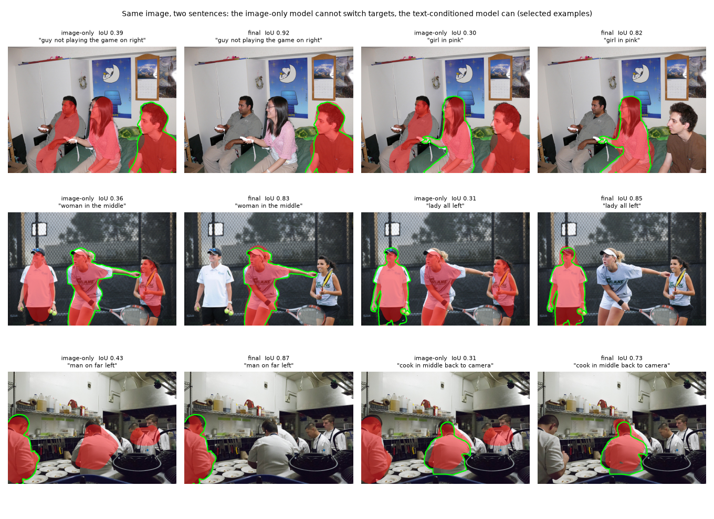
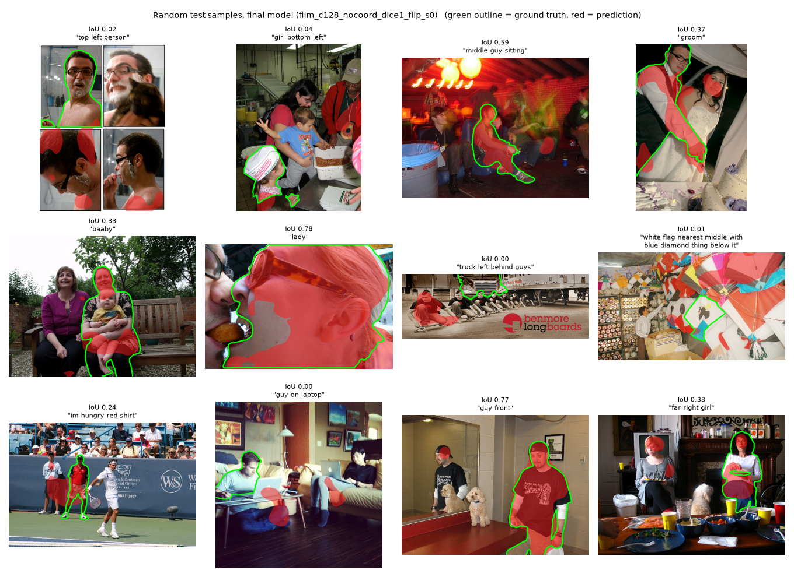
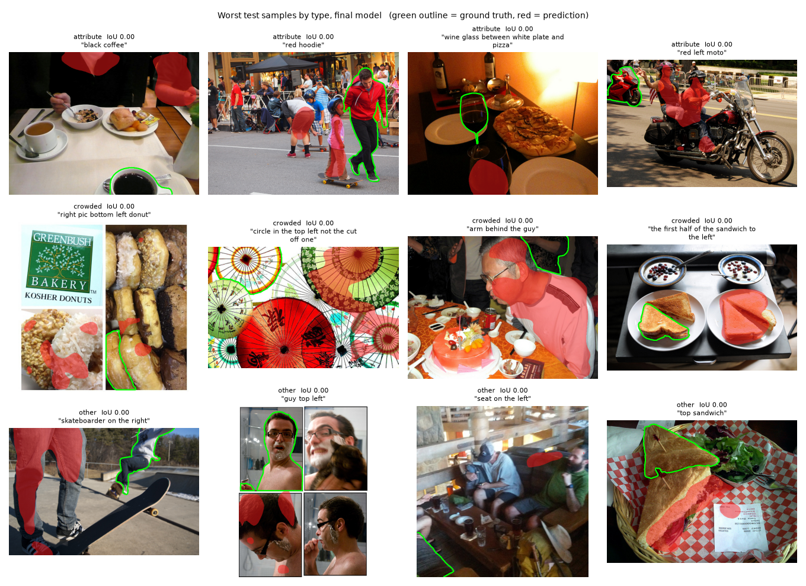
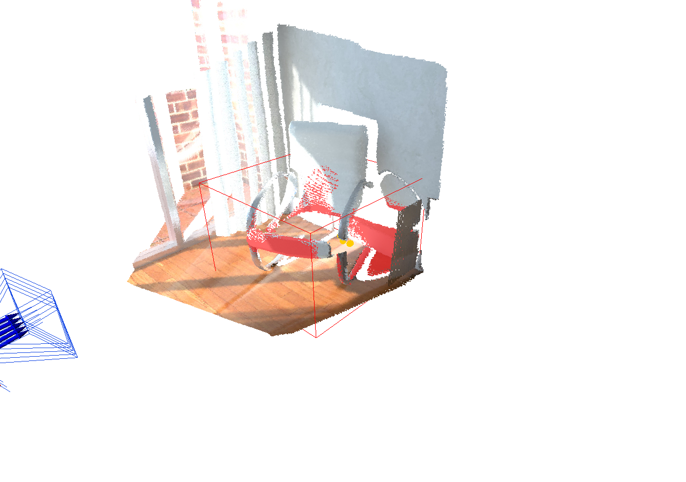
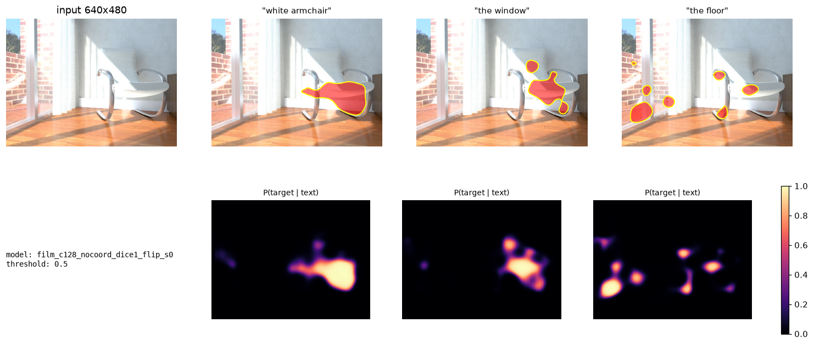

# text-guided-segmentation-3d

Language-conditioned image segmentation on **frozen CLIP features** with a small trainable
decoder, plus **RGB-D back-projection** of the predicted mask into a 3D point cloud.

Given an RGB image and a sentence such as *"woman in the middle"*, the model predicts a pixel
mask of the referred object. With aligned depth and camera intrinsics, the mask is lifted to 3D,
placed in a world frame and rendered as a highlighted point cloud.

> Computer Graphics course project. The numbers below come from a custom split of RefCOCO-M and
> are **internal course experiments, not official benchmark results**.



## Scope

- **Task:** referring-expression segmentation (an object named explicitly by the text).
  This is a first step toward robotic affordance grounding, **not** affordance grounding itself.
- **Data:** [RefCOCO-M](https://huggingface.co/datasets/moondream/refcoco-m) (MIT): 1,190 images,
  2,080 masks, 5,598 sentences. It ships one split only, so we split **by image** (seed 0):
  train 833 / val 178 / test 179 images (3,952 / 857 / 789 sentences). The split is in `splits/`.
- **Frozen encoder:** [`openai/clip-vit-base-patch16`](https://huggingface.co/openai/clip-vit-base-patch16),
  patch tokens from layers 3, 6, 9 and 12, cached once.
- **Protocol:** every variant is trained with 3 seeds, with early stopping on val mIoU. All
  configuration choices were made on val. The test set was evaluated **once**, at the end.

## Model

```
image ─ frozen CLIP ViT-B/16 ─ patch tokens (4 layers × 14×14×768) ─ LayerNorm + Linear → 128 ch ─┐
text  ─ frozen CLIP text encoder ─ 512-d embedding ─ MLP → FiLM (γ, β) ──────────────────────────→ (1+γ)·F + β
                                                     conv 14² → FiLM → up 28² → conv → up 56² → 1×1 → 224² logits
```

| ID | Text fusion | Trainable params | Notes |
|---|---|---|---|
| M0 | none | 0.66 M | Image-only baseline: same decoder, no text |
| M1 | FiLM | 1.05 M | Text sets a per-channel scale and shift, at two decoder stages |
| M1b | concat | 0.85 M | Text embedding broadcast and concatenated to the features |
| **Final** | FiLM | 1.05 M | M1, no coordinate channels, **horizontal flip with left↔right swapped text** |
| CLIPSeg | pretrained | 0 (151 M frozen) | [`CIDAS/clipseg-rd64-refined`](https://huggingface.co/CIDAS/clipseg-rd64-refined), external reference only |

Loss: BCE + soft Dice. AdamW (lr 3e-4, weight decay 0.01), one-cycle schedule, batch 32, ≤30 epochs.
Training one model takes about 30–40 s on an RTX 4060 Laptop GPU.

## Results (held-out test set, 789 sentences / 179 images, mean ± std over 3 seeds)

| Variant | mIoU ↑ | Dice ↑ | P@0.5 ↑ | spatial sentences | other sentences |
|---|---:|---:|---:|---:|---:|
| M0 image-only | 0.281 ± 0.002 | 0.397 | 0.179 | 0.253 | 0.333 |
| M1 FiLM | 0.375 ± 0.013 | 0.478 | 0.375 | 0.375 | 0.375 |
| M1b concat | 0.353 ± 0.012 | 0.456 | 0.341 | 0.350 | 0.358 |
| M1 FiLM, no coordinate channels | 0.375 ± 0.005 | 0.478 | 0.381 | 0.370 | 0.383 |
| M1 FiLM, BCE only | 0.332 ± 0.009 | 0.428 | 0.319 | 0.325 | 0.345 |
| + dropout & weight decay (R1) | 0.392 ± 0.013 | 0.495 | 0.398 | 0.390 | 0.396 |
| **+ flip, left↔right swap (R2, final)** | **0.393 ± 0.013** | **0.498** | **0.400** | 0.386 | 0.407 |
| + both (R3) | 0.403 ± 0.012 | 0.506 | 0.414 | 0.403 | 0.404 |
| CLIPSeg (reference, threshold 0.25 chosen on val) | 0.385 | 0.492 | 0.371 | 0.307 | **0.530** |

P@0.5 is the share of sentences where the predicted mask has IoU > 0.5 with the ground truth.
"Spatial sentences" (left, right, behind, second, …) make up about two thirds of the data.
Latency: about 5.5 ms per image + sentence end to end at batch 1 (CLIP ≈ 4.7 ms, decoder ≈ 0.8 ms),
compared with 7.7 ms for CLIPSeg. Full tables: [`report/results_test.md`](report/results_test.md),
[`report/results_val.md`](report/results_val.md),
[`report/results_val_regularisation.md`](report/results_val_regularisation.md).

### Findings

1. **Text conditioning works.** FiLM beats the image-only decoder by **+0.094 mIoU** (3/3 seeds);
   P@0.5 goes from 0.18 to 0.38. On 91 test images with two described objects, the final model
   gets **both** sentences right (IoU > 0.5) in 19.8% of cases, the image-only model in 0%.
2. **FiLM beats concatenation** by +0.021 ± 0.004 (3/3 seeds). The effect is small, and FiLM
   also has about 0.2 M more parameters.
3. **Dice matters.** BCE + Dice beats BCE alone by +0.043 mIoU.
4. **Coordinate channels add nothing.** CLIP's patch tokens already encode position.
5. **Flip augmentation reduces overfitting.** The train–val mIoU gap falls from 0.35 to 0.28, and
   test mIoU rises by +0.018. The word swap is essential: 48% of sentences contain "left" or "right".
   R3 is numerically highest on test, but the difference from R2 is within seed variation, and R2
   was chosen on val.
6. **Our model and CLIPSeg have complementary strengths.** Overall mIoU is level (0.393 vs 0.385,
   within seed variation). Our decoder is much better on spatial references (0.386 vs 0.307);
   CLIPSeg is much better on object names and attributes (0.530 vs 0.407).
7. **Hard cases:** sentences with colour or clothing words (0.320 mIoU vs 0.419 for the rest) and
   crowded images with 4 or more annotated objects (0.233). See
   [`gallery_failures.png`](report/figures/gallery_failures.png).

| | |
|---|---|
|  |  |
| Random test samples (not selected by outcome) | Worst test samples by type |

## Graphics module: mask → 3D

With calibrated RGB-D data, every masked pixel is lifted to 3D with the pinhole model and moved
into the world frame with the camera pose:

```
Z = depth(u, v) / 1000      X = (u - cx) · Z / fx      Y = (v - cy) · Z / fy
P_world = T_world_camera · [X, Y, Z, 1]ᵀ               (Open3D extrinsic = T_world_camera⁻¹)
```

Back-projection, the world transform and rendering use Open3D. `tests/test_projection.py` checks
that Open3D follows exactly these formulas and conventions. Before lifting, the mask is cleaned:
small blobs are removed and its edges are eroded to avoid "flying" points at depth discontinuities.
On the 5-frame Redwood RGB-D sample, the chair found from "the chair" lands at the same world
position from all five camera poses to within **3.0 cm** mean (4.4 cm max).

| | |
|---|---|
|  |  |
| "white armchair": target in red, 5 camera frustums, centroids (yellow), box | Out of domain: "the window" and "the floor" fail |

Derivation, mask cleanup, checks and limitations: [`report/graphics.md`](report/graphics.md).

## Setup and usage

Requires [pixi](https://pixi.sh) and an NVIDIA GPU with a CUDA 12 driver
(developed on an RTX 4060 Laptop, 8 GB).

```bash
pixi install                  # Python 3.12 + PyTorch (CUDA) + transformers + Open3D
pixi run smoke-test           # download CLIP/CLIPSeg, check shapes and VRAM
pixi run inspect-data         # dataset stats, split check, 20 overlays -> outputs/inspect/
pixi run test                 # unit tests (split, masks, shapes, projection, regularisation)

pixi run cache-features && pixi run cache-features --flip   # frozen CLIP features -> data/cache/
pixi run experiments --group main                           # M0/M1/M1b/ablations x 3 seeds + CLIPSeg, val
pixi run experiments --group reg                            # regularisation study, val
pixi run experiments --group all --partition test --i-am-done-tuning   # final test table (once)
pixi run gallery                                            # qualitative test figures -> report/figures/

pixi run demo path/to/image.jpg "the red cup on the left" "the plate"   # any image + sentences
pixi run viz3d --text "white armchair" --frames 0 1 2 3 4 --show        # 3D demo on Redwood RGB-D
```

## Layout

```
src/data/refcoco_m.py       dataset loading, RLE decoding, image-grouped split, torch Dataset
src/features.py             frozen CLIP wrapper, GPU feature cache, flip cache and left/right swap
src/models/decoder.py       decoder with fusion = none | film | concat, optional dropout
src/train.py, evaluate.py   training (early stopping on val mIoU) and comparison of runs
src/clipseg_baseline.py     off-the-shelf CLIPSeg reference
src/predict.py              inference on any image + sentence (final model by default)
src/visualize_3d.py         RGB-D back-projection and Open3D rendering
scripts/                    caching, experiments, gallery, demo, dataset inspection
splits/                     fixed train/val/test image ids
tests/                      unit tests
report/                     result tables, figures, 3D module write-up
outputs/, data/             checkpoints, caches, generated figures (not committed)
```

## Limitations

- **Little training data.** RefCOCO-M is an evaluation-quality dataset (refined masks for the
  original RefCOCO *validation* images). Training on 833 images causes clear overfitting: the
  train–val gap is still about 0.28 with flip augmentation. Training on the original RefCOCO
  train split (~17k images, no image overlap) is the natural next step.
- **Coarse masks.** The decoder predicts at 56×56, upsampled to the image, so thin structures and
  exact boundaries are lost.
- **Objects only.** RefCOCO annotates objects, so background regions (floor, wall, window) cannot be
  segmented by name. The model falls back to the most prominent object.
- **Domain shift in the 3D demo.** The model is trained on COCO photographs, and Redwood is a
  synthetic render. The chair mask covers mainly the seat.
- **3D results are localisation and visualisation**, not grasp planning or manipulation. RefCOCO-M
  has no depth, so the 3D demo uses separate RGB-D data.
- CLIP and CLIPSeg may have seen COCO images during pretraining.
